> Kubernetes 通过标准化的开放接口（CRI、CNI、CSI），实现了计算、网络和存储资源的解耦与可扩展，推动了云原生生态的繁荣。

## 核心开放接口概览

Kubernetes 提供了三个核心开放接口（CRI、CNI、CSI），分别管理分布式系统中最基础的计算、网络、存储资源；近年来设备注入层面又形成了 CDI 标准。下表总结了各接口的功能、作用及主流实现：



| 接口名称 | 全称                  | 主要功能         | 作用说明                   | 常见实现                          |
|----------|----------------------|------------------|----------------------------|------------------------------------|
| CRI      | 容器运行时接口        | 计算资源管理     | 标准化容器运行时交互        | containerd、CRI-O、cri-dockerd（Docker Engine 适配器） |
| CNI      | 容器网络接口          | 网络资源管理     | 统一容器网络配置与管理      | Cilium、Calico、Flannel、Antrea、Kube-OVN |
| CSI      | 容器存储接口          | 存储资源管理     | 标准化存储卷生命周期管理    | AWS EBS CSI、GCE PD CSI、Azure Disk CSI、Ceph-CSI、Longhorn |
| CDI      | 容器设备接口          | 设备注入         | 用规范文件描述设备暴露给容器所需的运行时修改 | containerd、CRI-O、Podman、Docker（消费）；NVIDIA/Intel 设备插件与 DRA 驱动（生产） |



### 容器运行时接口（CRI）

- **功能**：提供计算资源管理
- **作用**：标准化容器运行时的交互方式
- **常见实现**：containerd、CRI-O；Docker Engine 需经 cri-dockerd 适配接入

### 容器网络接口（CNI）

- **功能**：提供网络资源管理
- **作用**：统一容器网络配置和管理
- **常见实现**：Cilium、Calico、Flannel、Antrea、Kube-OVN（Weave Net 已停止维护）

### 容器存储接口（CSI）

- **功能**：提供存储资源管理
- **作用**：标准化存储卷的生命周期管理
- **常见实现**：各云厂商 CSI 驱动、Ceph-CSI、Longhorn、OpenEBS

### 容器设备接口（CDI）

- **功能**：标准化设备（GPU、FPGA、NIC 等）向容器的注入
- **作用**：厂商只需生成一份 CDI 规范，所有运行时即可理解；是设备插件与 DRA 的运行时侧落地机制
- **常见实现**：containerd 2.x、CRI-O、Podman、Docker 28+ 消费规范；NVIDIA Container Toolkit、各厂商 DRA 驱动生成规范

## 插件化架构优势

Kubernetes 的插件化架构设计带来了如下优势：

- **解耦合**：各组件职责明确，便于独立开发和维护。
- **可扩展**：支持多种实现方案，满足不同场景需求。
- **标准化**：统一接口规范，降低集成复杂度。
- **生态丰富**：促进云原生生态系统的繁荣发展。

除了 CRI、CNI、CSI 三大接口，Kubernetes 近年来还在设备与硬件层面形成了新的标准：**容器设备接口（Container Device Interface，CDI）** 由 CNCF TAG Runtime 维护，用与运行时无关的规范文件描述如何把 GPU 等设备注入容器，已被 containerd、CRI-O、Podman、Docker 支持，是节点侧的第四个开放接口，详见 [容器设备接口（CDI）](../cdi)；在其之上，**设备插件（Device Plugin）** 通过 gRPC 向 kubelet 上报扩展资源（v1.31 起可返回 CDI 设备名），**动态资源分配（Dynamic Resource Allocation，DRA）** 以 `resource.k8s.io` API 组（v1.34 GA）为异构设备提供声明式、可协商的分配模型，并只通过 CDI 完成注入。后两者在 [扩展 Kubernetes](../../extend) 与 [AI 原生](../../ai-native) 章节中有详细介绍。

## 开放接口协作关系图

下图展示了 Kubernetes 通过 CRI、CNI、CSI 三大接口将计算、网络、存储资源有机结合，形成完整的分布式应用运行平台：

## 总结

Kubernetes 通过 CRI、CNI、CSI 以及新近的 CDI 等开放接口实现了计算、网络、存储、设备四类核心资源的解耦与标准化，极大提升了平台的可扩展性和生态兼容性。插件化架构为云原生基础设施的演进和创新提供了坚实基础。

## 参考文献

- [Kubernetes CRI 设计文档 - kubernetes.io](https://kubernetes.io/zh/docs/concepts/architecture/cri/)
- [Container Device Interface - github.com](https://github.com/cncf-tags/container-device-interface)
- [Kubernetes CNI 设计文档 - kubernetes.io](https://kubernetes.io/zh/docs/concepts/extend-kubernetes/compute-storage-net/network-plugins/)
- [Kubernetes CSI 设计文档 - kubernetes.io](https://kubernetes.io/zh/docs/concepts/storage/volumes/#csi)
