> 原生 Sidecar 让"辅助容器先于主容器启动、晚于主容器退出"从一堆 workaround 变成了 Kubernetes 的一等语义，这是 Pod 模型近年来最重要的补课。

## Sidecar 容器的特点

Sidecar 容器（Sidecar Container）是指与主容器（Main Container）共同运行在同一个 Pod 内的辅助容器。它们具有如下特点：

- **共享资源**：与主容器共享网络命名空间、存储卷和生命周期。
- **松耦合**：功能独立，可单独更新和维护。
- **透明性**：对主应用透明，无需修改主应用代码。
- **可重用性**：可在多个不同应用中复用。

下图展示了 Sidecar 容器与主容器的协作关系：



在 Kubernetes v1.29 之前，"Sidecar"只是一种设计模式：把辅助容器和主容器并列写进 `spec.containers`，由用户自行解决启动顺序、退出时机等问题。自 v1.29 起，Kubernetes 提供了**原生 Sidecar 容器**（Native Sidecar Containers）这一正式特性（KEP-753，v1.29 Beta 并默认开启，v1.33 GA），本文以原生 Sidecar 为主线展开。

## 原生 Sidecar 容器

原生 Sidecar 容器的定义方式非常简洁：**在 `spec.initContainers` 中声明容器，并把该容器的 `restartPolicy` 设置为 `Always`**。满足这一条件的 Init 容器会被 kubelet 识别为 Sidecar，获得与普通 Init 容器完全不同的生命周期。

下面的示例在 Pod 中声明了一个日志收集 Sidecar：

```yaml
apiVersion: v1
kind: Pod
metadata:
  name: app-with-native-sidecar
spec:
  initContainers:
  - name: log-collector
    image: fluent/fluent-bit:3.2
    restartPolicy: Always   # 关键：将 Init 容器标记为 Sidecar
    volumeMounts:
    - name: shared-logs
      mountPath: /var/log/app
  containers:
  - name: app
    image: my-app:1.0
    volumeMounts:
    - name: shared-logs
      mountPath: /var/log/app
  volumes:
  - name: shared-logs
    emptyDir: {}
```

与传统的"并列容器"写法相比，原生 Sidecar 在以下几个方面有本质差异。

### 启动顺序

Sidecar 容器按在 `initContainers` 中的声明顺序，与其他 Init 容器一起**顺序启动**。普通 Init 容器需要运行完成（退出码为 0）后下一个容器才会启动；而 Sidecar 容器只要**启动成功**（若配置了 `startupProbe`，则需探针通过）就视为"完成"，随后启动下一个 Init 容器或主容器。这意味着可以精确保证"代理先于业务进程就绪"，例如服务网格代理先建立好出站连接能力，业务容器再启动。

### 退出时机

Pod 终止时，kubelet 先向主容器发送 `SIGTERM`，待所有主容器退出后，再以**与启动相反的顺序**终止 Sidecar 容器。这解决了长期困扰 Job 场景的问题：业务容器已经退出，但日志或代理 Sidecar 仍在运行，导致 Pod 永远无法进入 `Succeeded` 状态。使用原生 Sidecar 后，Job 的 Pod 会在主容器完成后自动结束。

### 重启行为

Sidecar 容器拥有独立于 Pod `restartPolicy` 的重启语义：即便 Pod 的 `restartPolicy` 是 `Never` 或 `OnFailure`，Sidecar 容器崩溃后仍会被 kubelet 重启，且**不会触发其他 Init 容器重新执行**。这保证了 Sidecar 在整个 Pod 生命周期内持续可用。

### 探针与钩子支持

与普通 Init 容器不同，Sidecar 容器支持完整的 `startupProbe`、`livenessProbe`、`readinessProbe` 以及 `postStart`、`preStop` 生命周期钩子。其中 `readinessProbe` 的结果会参与 Pod 的 `Ready` 条件计算，因此 Sidecar 不就绪也会让 Pod 从 Service 端点中摘除。

下表对比了三类容器的关键行为差异：



| 行为             | 普通 Init 容器              | 原生 Sidecar 容器                        | 主容器（containers）     |
|------------------|-----------------------------|------------------------------------------|--------------------------|
| 声明位置         | `initContainers`            | `initContainers` + `restartPolicy: Always` | `containers`             |
| 启动顺序         | 顺序，完成后才启动下一个    | 顺序，启动成功后即进入下一个              | 所有 Init 阶段结束后并行 |
| 运行时长         | 一次性，运行完成即退出      | 与 Pod 同寿命                            | 与 Pod 同寿命            |
| 终止顺序         | 不适用                      | 在所有主容器退出后逆序终止                | 先于 Sidecar 终止        |
| 重启             | 失败按 Pod `restartPolicy`  | 始终重启，独立于 Pod `restartPolicy`      | 按 Pod `restartPolicy`   |
| 探针             | 不支持                      | 支持 startup/liveness/readiness          | 支持                     |
| 是否阻塞 Job 完成 | 不适用                      | 否                                       | 是                       |



### 资源计算

引入 Sidecar 后，Pod 有效资源请求的计算方式随之调整。Sidecar 容器的资源会与主容器**累加**（因为二者同时运行），而普通 Init 容器仍按"取最大值"规则参与计算。Pod 的有效请求为：

```text
max(
  sum(主容器请求) + sum(Sidecar 请求),
  max(每个普通 Init 容器请求 + 其之前已启动的 Sidecar 请求之和)
)
```

调度器与 kubelet 的资源准入都按这一规则执行，因此为 Sidecar 设置合理的 `requests`/`limits` 直接影响 Pod 的可调度性。

## 传统多容器写法

在不支持原生 Sidecar 的旧集群（v1.28 及更早）中，Sidecar 只能作为普通容器与主容器并列声明。以下示例展示了传统写法：

```yaml
apiVersion: v1
kind: Pod
metadata:
  name: app-with-sidecar
spec:
  containers:
  - name: app
    image: my-app:latest
    volumeMounts:
    - name: shared-logs
      mountPath: /var/log
  - name: log-collector
    image: fluent/fluent-bit:latest
    volumeMounts:
    - name: shared-logs
      mountPath: /var/log
  volumes:
  - name: shared-logs
    emptyDir: {}
```

这种写法下所有容器并行启动、同时收到终止信号，启动顺序与退出顺序均无法保证，需要借助 `postStart` 阻塞、启动脚本轮询或业务代码重试等手段规避。如今的集群版本已普遍支持原生 Sidecar，建议新工作负载直接采用 `initContainers + restartPolicy: Always` 的写法；需要同时兼容新旧版本的 Helm Chart 可通过 `.Capabilities.KubeVersion` 做条件渲染。

## 常见使用场景

原生 Sidecar 覆盖了传统 Sidecar 模式的全部场景，并在启动顺序和退出时机敏感的场景中体现出明显优势。

### 服务网格代理

Istio 自 1.19 起支持以原生 Sidecar 方式注入 Envoy 代理（`ENABLE_NATIVE_SIDECARS=true`），代理会先于业务容器启动并建立好流量拦截规则，彻底解决业务容器启动时因代理尚未就绪而出现的连接失败问题。以下示例展示了手动声明代理 Sidecar 的方式：

```yaml
apiVersion: v1
kind: Pod
metadata:
  name: app-with-proxy
spec:
  initContainers:
  - name: envoy-proxy
    image: envoyproxy/envoy:v1.32-latest
    restartPolicy: Always
    ports:
    - containerPort: 9901
    startupProbe:
      httpGet:
        path: /ready
        port: 9901
      periodSeconds: 1
      failureThreshold: 30
  containers:
  - name: app
    image: my-app:1.0
    ports:
    - containerPort: 8080
```

### Job 中的日志与凭据代理

批处理 Job 是原生 Sidecar 最直接的受益者。以往在 Job 中附带 Cloud SQL Proxy、Vault Agent 或日志采集器时，主进程结束后 Sidecar 仍在运行，Job 无法完成。使用原生 Sidecar 后无需任何额外处理：

```yaml
apiVersion: batch/v1
kind: Job
metadata:
  name: db-migration
spec:
  template:
    spec:
      restartPolicy: Never
      initContainers:
      - name: cloud-sql-proxy
        image: gcr.io/cloud-sql-connectors/cloud-sql-proxy:2.14.0
        restartPolicy: Always
        args: ["--port=5432", "my-project:region:instance"]
      containers:
      - name: migrate
        image: my-app:1.0
        command: ["python", "manage.py", "migrate"]
```

### 配置热更新

Sidecar 容器可用于监听 ConfigMap 变更并通知主容器重新加载配置，无需重启主容器：

```yaml
apiVersion: v1
kind: Pod
metadata:
  name: app-with-config-watcher
spec:
  initContainers:
  - name: config-watcher
    image: jimmidyson/configmap-reload:v0.14.0
    restartPolicy: Always
    args:
    - --volume-dir=/etc/config
    - --webhook-url=http://localhost:8080/-/reload
    volumeMounts:
    - name: config-volume
      mountPath: /etc/config
  containers:
  - name: app
    image: my-app:1.0
    volumeMounts:
    - name: config-volume
      mountPath: /etc/config
  volumes:
  - name: config-volume
    configMap:
      name: app-config
```

## 最佳实践

在实际应用中，建议遵循以下最佳实践以提升 Sidecar 容器的可维护性和稳定性。

### 用 startupProbe 表达"就绪即放行"

Sidecar 的启动完成判定依赖 `startupProbe`。若不配置探针，kubelet 在容器进程启动后立即放行下一个容器，无法保证 Sidecar 已真正可用。对代理、凭据注入等强依赖场景务必配置 `startupProbe`：

```yaml
initContainers:
- name: vault-agent
  image: hashicorp/vault:1.18
  restartPolicy: Always
  startupProbe:
    exec:
      command: ["test", "-f", "/vault/secrets/ready"]
    periodSeconds: 1
    failureThreshold: 60
```

### 资源管理

为 Sidecar 容器合理分配资源，避免影响主业务容器。Sidecar 的资源会与主容器累加计入 Pod 总量，过大的 `requests` 会直接降低 Pod 的可调度性：

```yaml
initContainers:
- name: sidecar
  image: sidecar:1.0
  restartPolicy: Always
  resources:
    requests:
      memory: "64Mi"
      cpu: "50m"
    limits:
      memory: "128Mi"
      cpu: "100m"
```

### 优雅关闭

Sidecar 在主容器全部退出后才收到 `SIGTERM`，因此通常不再需要 `preStop: sleep` 来"等主容器先走"。如果 Sidecar 自身需要清理（例如刷出缓冲区的日志），可使用 `preStop` 钩子；`lifecycle` 钩子支持原生 `sleep` 动作（v1.34 GA），无需依赖容器镜像内的 shell：

```yaml
initContainers:
- name: log-collector
  image: fluent/fluent-bit:3.2
  restartPolicy: Always
  lifecycle:
    preStop:
      sleep:
        seconds: 5
```

### 注意 terminationGracePeriodSeconds 的分配

Pod 的 `terminationGracePeriodSeconds`（默认 30 秒）是主容器与 Sidecar **共享**的总预算。主容器若耗尽大部分宽限期，Sidecar 可能被直接 `SIGKILL`。对需要较长收尾时间的 Sidecar，应相应调大 Pod 级宽限期。

## 注意事项

在设计和使用 Sidecar 容器时需关注以下问题：

- **资源消耗**：每个 Sidecar 容器都会消耗额外的 CPU 和内存资源，在大规模集群中会被显著放大，可评估服务网格 Ambient 模式等无 Sidecar 方案。
- **复杂性提升**：增加 Pod 复杂性，调试和监控难度提升；`kubectl get pod` 的 `READY` 列会把 Sidecar 计入容器总数。
- **版本兼容**：旧集群（v1.28 及更早）不识别 Init 容器的 `restartPolicy` 字段，API Server 会拒绝该 Pod；跨版本分发的 Chart 需做条件渲染。
- **工具链支持**：部分旧版本的 Operator、准入 Webhook 只遍历 `spec.containers`，可能漏掉声明在 `initContainers` 中的 Sidecar，需要确认生态工具已适配。

## 总结

原生 Sidecar 容器将"辅助容器先启动、后退出、独立重启"固化为 Kubernetes 的内建语义，解决了传统多容器模式在启动顺序和 Job 完成判定上的长期痛点。在 v1.29 及更高版本的集群中，应优先使用 `initContainers + restartPolicy: Always` 声明 Sidecar，并配合 `startupProbe` 表达就绪条件、合理规划资源与终止宽限期。传统并列容器写法仅在兼容旧集群时保留。

## 参考文献

- [Sidecar Containers - kubernetes.io](https://kubernetes.io/docs/concepts/workloads/pods/sidecar-containers/)
- [Kubernetes v1.29: Native Sidecar Containers Beta - kubernetes.io](https://kubernetes.io/blog/2023/08/25/native-sidecar-containers/)
- [KEP-753: Sidecar Containers - github.com](https://github.com/kubernetes/enhancements/tree/master/keps/sig-node/753-sidecar-containers)
- [Istio Native Sidecars Support - istio.io](https://istio.io/latest/blog/2023/native-sidecars/)
