> Gateway API Inference Extension 为 Kubernetes AI/ML 推理工作负载提供了标准化、声明式的流量管理和智能路由能力，极大提升了模型服务的可扩展性与可维护性。

## 引言

本文系统介绍了 Kubernetes Gateway API Inference Extension 的架构、核心组件、关键资源、请求处理流程、调度算法及最佳实践，帮助读者全面理解其在 AI 推理场景下的应用价值。

## 什么是 Gateway API Inference Extension

Gateway API Inference Extension 是 Kubernetes Gateway API 的一个扩展，专为 AI/ML 推理工作负载设计。它提供标准化 API，便于管理 AI 模型服务的路由、负载均衡和流量控制。

### 核心特性

- 模型路由：基于模型名称、版本等进行路由
- 负载均衡：AI 推理服务的智能负载均衡
- 流量分割：支持金丝雀发布和 A/B 测试
- 服务发现：自动发现和注册 AI 服务
- 安全控制：API 密钥管理和访问控制

## 架构概述

下图展示了 Gateway API Inference Extension 的整体架构：



### 组件说明

- Gateway：入口网关，处理外部请求
- InferencePool：推理服务池，管理多个模型服务
- InferenceExtension：推理扩展，提供 AI 特定功能
- Model Servers：实际的模型推理服务

## 核心组件详解

Gateway API Inference Extension 由四个主要组件协同工作，提供智能推理路由能力。

### Gateway

Gateway 是支持 Gateway API 且实现 ext-proc 的 Kubernetes 代理。常见实现包括 Istio、Agentgateway、NGINX Gateway Fabric、kgateway 与 GKE Gateway。Gateway 负责 L4-L7 路由，并通过 gRPC 流与扩展组件集成。

### Body-Based Router (BBR)

BBR 是可选 ext-proc 服务器，从 OpenAI 格式请求体中提取 `model` 字段，并注入 `X-Gateway-Model-Name` 头部，便于 HTTPRoute 按模型名称路由。该组件现由 llm-d 社区维护。

### Endpoint Picker Proxy (EPP)

EPP 是核心智能组件，实现调度和路由逻辑。其主要子模块包括：

- StreamingServer：处理 Envoy 的双向 gRPC 协议
- Director：协调请求生命周期和插件执行
- Scheduler：执行 Filter → Score → Pick 流水线
- Datastore：缓存 Kubernetes 资源和 Pod 指标
- Controllers：协调 InferencePool、InferenceObjective 和 Pod 资源

### Model Servers

后端 Pod 运行推理服务器（如 vLLM、Triton、SGLang），需实现协议以公开调度决策指标。

## 核心 Kubernetes 资源

下表总结了扩展引入的自定义 Kubernetes 资源及其作用：



| 资源 | API 版本 | 状态 | 目的 |
| --- | --- | --- | --- |
| InferencePool | `inference.networking.k8s.io/v1` | GA（v1.0 起） | 定义模型服务器 Pod 池，并通过 `endpointPickerRef` 引用 EPP 服务进行端点选择；在 Gateway API 资源模型中充当"后端"，替代 Service |
| InferencePoolImport | `inference.networking.x-k8s.io/v1alpha1` | 实验 | 由多集群控制器自动生成，代表从其他集群导入的 InferencePool，用于跨集群路由 |
| Gateway | `gateway.networking.k8s.io/v1` | 标准 Gateway API 资源 | 入口网关，需实现 ext-proc 以与 EPP 集成 |
| HTTPRoute | `gateway.networking.k8s.io/v1` | 标准 Gateway API 资源 | 通过 `backendRefs` 将流量路由到 InferencePool 后端而非标准 Service |



需要注意的是，项目在 v1.6 前后经历了一次职责拆分：EPP 参考实现、`InferenceObjective`/`InferenceModelRewrite` API 以及 Body-Based Router（BBR）已迁移到 [llm-d/llm-d-router](https://github.com/llm-d/llm-d-router) 与 [llm-d/llm-d-inference-payload-processor](https://github.com/llm-d/llm-d-inference-payload-processor) 仓库继续演进；`kubernetes-sigs/gateway-api-inference-extension` 仓库本身只保留 InferencePool API、轻量级 EPP（LWEPP）参考实现与一致性测试。因此在阅读文档时要区分"API 标准"（本项目）与"调度器实现"（llm-d 等）。

下图展示了资源之间的关系：



## 请求处理流程

推理请求的处理流程分为两段：下图先展示网关、BBR 与 EPP 之间的 ext-proc 交互。



EPP 收到请求后，内部由 StreamingServer、Director、Scheduler 与 Datastore 协作完成饱和检测与调度：



**关键阶段说明：**

1. Body Parsing：BBR 从请求体提取模型名称
2. Route Matching：Gateway 根据头部匹配 HTTPRoute
3. Endpoint Selection：EPP Director 协调 Scheduler 选择最佳 Pod
4. Saturation Detection：检查系统是否过载
5. Scheduling：三阶段调度选择最佳 Pod

## 关键概念和术语

- **Inference Gateway (IGW)**：与 Endpoint Picker 耦合的代理/负载均衡器，基于实时指标智能路由。
- **Endpoint Picker Extension (EPP)**：推理调度器实现，扩展 Envoy 以注入路由决策。
- **指标和能力**：如队列深度、KV 缓存利用率、前缀缓存、LoRA 适配器等。
- **饱和检测**：EPP 监控系统负载，丢弃低优先级请求，相关阈值可配置。

## EPP 内部组件

下图展示了 EPP 应用的主要子系统及其关系：



**主要职责：**

- Runner：初始化和启动所有子系统
- StreamingServer：实现 Envoy 双向流协议
- Director：协调请求生命周期和插件执行
- Scheduler：执行调度流水线
- Datastore：缓存 Kubernetes 资源
- Controllers：同步 CRD 到数据存储
- Plugins：可扩展评分和选择策略

## 调度算法

EPP 采用三阶段调度算法，受 Kubernetes 调度器启发：



**评分权重说明：**

- KV 缓存：利用率越低分数越高
- 队列深度：请求越少分数越高
- LoRA 亲和：已加载适配器分数高
- 前缀缓存：命中前缀分数高

## 支持的平台

### Gateway 实现

Inference Extension 只定义 API 与扩展协议，具体能力取决于网关实现是否通过了项目的一致性测试。截至 v1.6.2，官方列出的合规实现如下：



| 实现 | 说明 |
| --- | --- |
| Istio | 完整实现 Gateway API 的服务网格与网关，支持南北向与 GAMMA 东西向流量 |
| Agentgateway | Rust 编写的 AI 网关，面向 LLM、MCP、A2A 流量，可独立运行或部署在 Kubernetes/llm-d 之上 |
| NGINX Gateway Fabric | 以 NGINX 为数据面的 Gateway API 实现 |
| kgateway、GKE Gateway | 早期版本即提供支持，GKE Inference Gateway 为 Google Cloud 托管实现 |



项目要求实现方在最近三个小版本内提交一致性报告，否则会从合规列表移除，因此选型时应以官方 [实现列表](https://gateway-api-inference-extension.sigs.k8s.io/implementations/gateways/) 为准。

### 模型服务器

后端模型服务器需要实现项目定义的 [模型服务器协议](https://github.com/kubernetes-sigs/gateway-api-inference-extension/tree/main/docs/proposals/003-model-server-protocol)，以 Prometheus 指标形式暴露队列长度、KV 缓存利用率、已加载 LoRA 适配器等调度所需信息：



| 服务器 | 支持级别 | 说明 |
| --- | --- | --- |
| vLLM | 完整 | 与 llm-d 深度集成，是参考实现的主要测试目标 |
| SGLang | 支持 | 需暴露协议要求的指标 |
| Triton Inference Server（TensorRT-LLM 后端） | 支持 | 需暴露协议要求的指标 |



## 安装与配置

### 前提条件

- 运行最近三个小版本之一的 Kubernetes 集群，支持 `LoadBalancer` 类型 Service
- 支持原生 Sidecar 容器（v1.29 起默认开启），模型服务器部署依赖该特性
- 已安装一个支持 Inference Extension 的 Gateway 实现（如 Istio、Agentgateway、kgateway）
- Helm 与 jq

### 安装 CRD

Gateway API 与 Inference Extension 的 CRD 分别独立发布。以下命令安装 Gateway API v1.7 标准渠道 CRD 与 Inference Extension v1.6.2 的 InferencePool CRD：

```bash
kubectl apply -f https://github.com/kubernetes-sigs/gateway-api/releases/download/v1.7.0/standard-install.yaml
kubectl apply -f https://github.com/kubernetes-sigs/gateway-api-inference-extension/releases/download/v1.6.2/manifests.yaml
```

如需 `InferencePoolImport` 等实验性资源，改用同一发布页中的 `experimental-manifests.yaml`。

### 创建 InferencePool

InferencePool 用标签选择器圈定一组同构的模型服务器 Pod（相同模型、相同加速器、相同服务框架），并引用 EPP 服务。`endpointPickerRef` 自 v1.5.0 起为可选字段，省略时由网关实现自行决定如何选择端点：

```yaml
apiVersion: inference.networking.k8s.io/v1
kind: InferencePool
metadata:
  name: vllm-qwen3-32b
spec:
  selector:
    matchLabels:
      app: vllm-qwen3-32b
  targetPorts:
    - number: 8000
  endpointPickerRef:
    name: vllm-qwen3-32b-epp
    port:
      number: 9002
    failureMode: FailOpen   # EPP 不可用时退化为网关默认负载均衡；FailClose 则直接拒绝请求
```

EPP 本身是一个普通的 Deployment + Service。项目早期在 `registry.k8s.io` 发布的 `inferencepool` Helm Chart 可同时创建 InferencePool 与 EPP（最后一个版本为 v1.5.0）；EPP 迁移到 llm-d 后，新的调度器及其 Chart 由 [llm-d-router](https://github.com/llm-d/llm-d-router) 提供：

```bash
helm install vllm-qwen3-32b \
  --set inferencePool.modelServers.matchLabels.app=vllm-qwen3-32b \
  --set provider.name=istio \
  --version v1.5.0 \
  oci://registry.k8s.io/gateway-api-inference-extension/charts/inferencepool
```

### 配置 Gateway

Gateway 的写法与普通 Gateway API 用法一致，`gatewayClassName` 指向已安装的实现：

```yaml
apiVersion: gateway.networking.k8s.io/v1
kind: Gateway
metadata:
  name: inference-gateway
spec:
  gatewayClassName: istio
  listeners:
  - name: http
    port: 80
    protocol: HTTP
```

### 用 HTTPRoute 路由到 InferencePool

Inference Extension 没有引入新的路由资源，而是复用标准 HTTPRoute，只需在 `backendRefs` 中把 `group`/`kind` 指向 InferencePool：

```yaml
apiVersion: gateway.networking.k8s.io/v1
kind: HTTPRoute
metadata:
  name: llm-route
spec:
  parentRefs:
  - name: inference-gateway
  rules:
  - matches:
    - path:
        type: PathPrefix
        value: /
    backendRefs:
    - group: inference.networking.k8s.io
      kind: InferencePool
      name: vllm-qwen3-32b
    timeouts:
      request: 300s     # LLM 生成耗时长，需放宽默认超时
```

部署完成后，可直接向网关地址发送 OpenAI 兼容请求验证：

```bash
IP=$(kubectl get gateway inference-gateway -o jsonpath='{.status.addresses[0].value}')
curl -i http://$IP/v1/completions -H 'Content-Type: application/json' \
  -d '{"model": "Qwen/Qwen3-32B", "prompt": "Kubernetes is", "max_tokens": 64}'
```

## 高级路由功能

### 按模型名称路由

OpenAI 兼容请求把模型名放在 JSON 请求体的 `model` 字段中，而 HTTPRoute 只能按路径、请求头等匹配。Body-Based Router（BBR，现由 llm-d 维护）作为网关的 ext-proc 过滤器解析请求体，把模型名写入 `X-Gateway-Model-Name` 请求头，随后 HTTPRoute 即可按该头部把不同模型分发到不同 InferencePool：

```yaml
apiVersion: gateway.networking.k8s.io/v1
kind: HTTPRoute
metadata:
  name: model-router
spec:
  parentRefs:
  - name: inference-gateway
  rules:
  - matches:
    - headers:
      - name: X-Gateway-Model-Name
        value: Qwen/Qwen3-32B
    backendRefs:
    - group: inference.networking.k8s.io
      kind: InferencePool
      name: vllm-qwen3-32b
  - matches:
    - headers:
      - name: X-Gateway-Model-Name
        value: meta-llama/Llama-3.1-8B-Instruct
    backendRefs:
    - group: inference.networking.k8s.io
      kind: InferencePool
      name: vllm-llama3-8b
```

### 流量分割与金丝雀发布

借助 HTTPRoute 的 `weight` 字段，可以在两个 InferencePool（例如新旧模型版本或不同量化精度）之间按比例分流，实现模型层面的金丝雀发布：

```yaml
    backendRefs:
    - group: inference.networking.k8s.io
      kind: InferencePool
      name: vllm-qwen3-32b
      weight: 90
    - group: inference.networking.k8s.io
      kind: InferencePool
      name: vllm-qwen3-32b-fp8
      weight: 10
```

### LoRA 适配器与请求优先级

同一个基础模型可以加载多个 LoRA 适配器，EPP 会根据各 Pod 已加载的适配器做亲和调度，避免频繁换入换出。请求优先级、关键性（criticality）以及模型名重写等能力由 llm-d-router 中的 `InferenceObjective`、`InferenceModelRewrite` API 提供，在系统饱和时可优先丢弃低优先级请求。

## 多集群推理

`InferencePoolImport` 资源（实验性）允许把其他集群中的 InferencePool 导入本地集群，网关据此把推理流量路由到远端集群的模型服务器，为跨区域 GPU 资源池化提供基础。该资源不由用户手写，而由多集群控制器填充。

## 监控与可观测性

EPP 与模型服务器均以 Prometheus 格式暴露指标：EPP 输出请求延迟、每个 Pod 的队列长度与 KV 缓存利用率快照、调度决策耗时等；模型服务器按协议暴露 `vllm:num_requests_waiting`、`vllm:gpu_cache_usage_perc` 等指标。推荐的做法是为 EPP 创建 `ServiceMonitor`/`PodMonitor`，并在 Grafana 中把网关侧的请求指标与模型侧的生成指标（TTFT、TPOT）关联分析。

## 最佳实践

- 一个 InferencePool 只包含同模型、同加速器、同服务框架的 Pod，异构配置拆分为多个池
- 生产环境为 EPP 部署多副本，并根据可用性要求在 `FailOpen` 与 `FailClose` 之间做出选择
- 把 HTTPRoute 的请求超时放宽到分钟级，流式响应需确认网关实现支持 SSE 透传
- 模型服务器 Pod 使用原生 Sidecar 承载 LoRA 适配器加载等辅助进程
- 结合 Gateway API 的 `BackendTLSPolicy` 对网关到模型服务器的链路加密

## 故障排除

常见问题及排查方向：

- 路由不生效：确认 HTTPRoute 的 `backendRefs.group` 为 `inference.networking.k8s.io`，并检查 Gateway 实现是否声明支持 InferencePool
- 请求全部走默认负载均衡：检查 EPP Pod 是否就绪、`endpointPickerRef` 端口是否正确，`FailOpen` 模式下 EPP 故障会被静默降级
- 调度不均衡：确认模型服务器暴露了协议要求的指标，EPP 日志中会提示缺失的指标名

```bash
kubectl get inferencepool -A
kubectl describe inferencepool vllm-qwen3-32b
kubectl get httproute llm-route -o yaml | yq '.status'
kubectl logs deploy/vllm-qwen3-32b-epp
```

## 项目状态

Gateway API Inference Extension 已于 2025 年发布 v1.0 并宣布 GA，InferencePool 为稳定的 `v1` API；截至 2026 年 10 月最新版本为 v1.6.2。项目与 vLLM 社区合作推出的 [llm-d](https://llm-d.ai/) 成为推荐的完整推理服务栈，EPP 调度器及其高级 API 的演进主要在 llm-d 相关仓库中进行。

## 总结

Gateway API Inference Extension 在不改变 Gateway API 资源模型的前提下，用 InferencePool 替代 Service 作为推理后端，并通过 ext-proc 协议把"根据 KV 缓存、队列深度、LoRA 亲和做调度"的能力插入网关数据面。它让 AI 推理流量管理获得了与普通微服务一致的声明式体验，是构建 Kubernetes AI 基础设施的重要组件。

## 参考文献

- [Gateway API Inference Extension - gateway-api-inference-extension.sigs.k8s.io](https://gateway-api-inference-extension.sigs.k8s.io/)
- [InferencePool API - gateway-api-inference-extension.sigs.k8s.io](https://gateway-api-inference-extension.sigs.k8s.io/api-types/inferencepool/)
- [Gateway API Inference Extension Releases - github.com](https://github.com/kubernetes-sigs/gateway-api-inference-extension/releases)
- [llm-d - llm-d.ai](https://llm-d.ai/)
